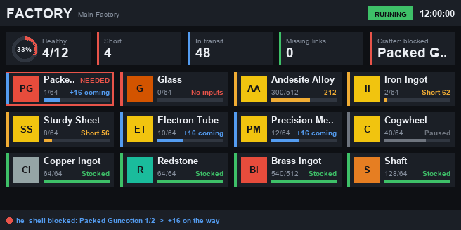

# CC Factory Monitor

ComputerCraft dashboard for a Create Factory Controller. It shows every gauge with its stock, target, items on the way and status, plus health, shortage, in-transit and missing-link totals and the Mech Crafter's activity. It also shares the gauge data over rednet so the [Mech Crafter](https://github.com/levisnakes/cc-mech-crafter) knows what to make.



## Install

```
wget https://raw.githubusercontent.com/levisnakes/cc-factory-monitor/main/factory_monitor.lua startup.lua
```

## Setup

- Put a wired modem on the Factory Controller and connect it to this computer.
- Connect a monitor and a DirectGPU block. Without DirectGPU it falls back to plain monitor text.
- Put this computer and the Mech Crafter computer on the same cable network, or give both a wireless modem, so they can talk over rednet.

Settings at the top of the file: `MONITOR`, `CONTROLLER` (both found automatically when left `nil`), `TITLE`, `PAGE_SECONDS`, `RESOLUTION`.

Tap the left or right half of the monitor to flip pages when there are more gauges than fit.

## Stuck alerts

Set `DISCORD_WEBHOOK` (and `DISCORD_MENTION`, e.g. `"<@&ROLE_ID>"`) at the top of the file to get a Discord ping only when something is really stuck, with what to restart or fix. Each problem is posted once, and a follow-up without a ping says when it's fixed.

- the crafting computer stopped reporting for 2+ minutes (restart the crafting computer)
- the Factory Controller can't be read for 2+ minutes (check its modem, restart this computer)

## config.lua

Anything in `/config.lua` on the computer overrides the settings at the top of the program, and survives reinstalls and updates. One file can be shared by every computer; each program ignores settings it doesn't use. Example:

```lua
DISCORD_WEBHOOK = "https://discord.com/api/webhooks/..."
DISCORD_MENTION = "<@&ROLE_ID>"
ALLOWED = { "YourName", "Friend" }
INPUT_CHEST = "minecraft:chest_3"
```
